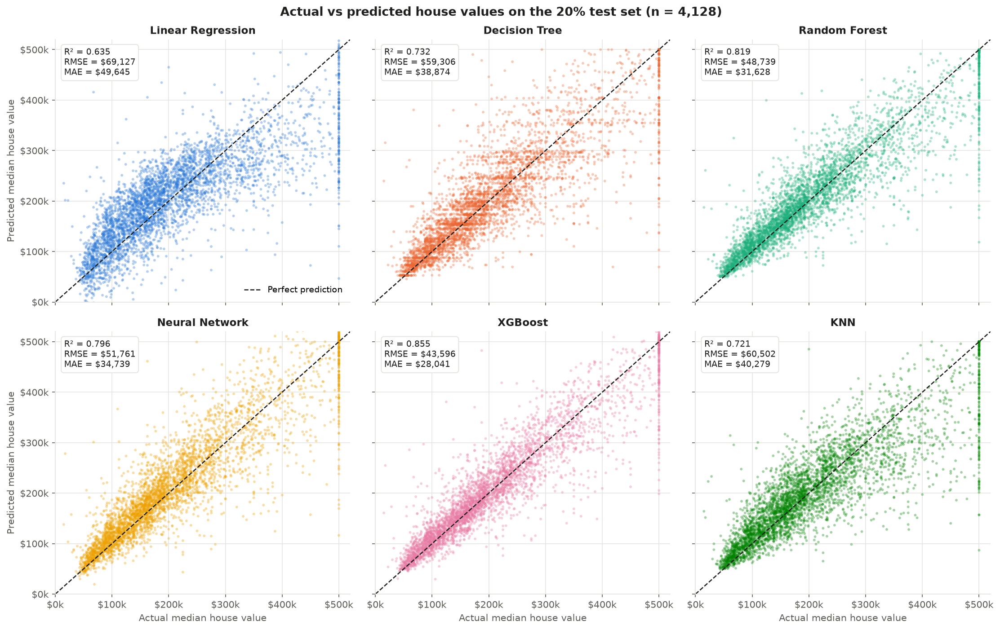
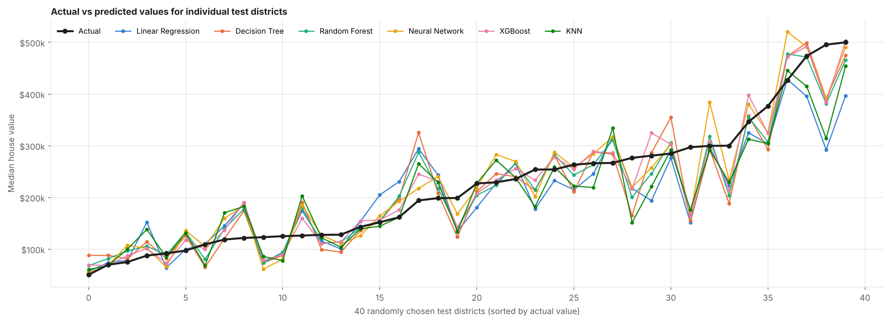
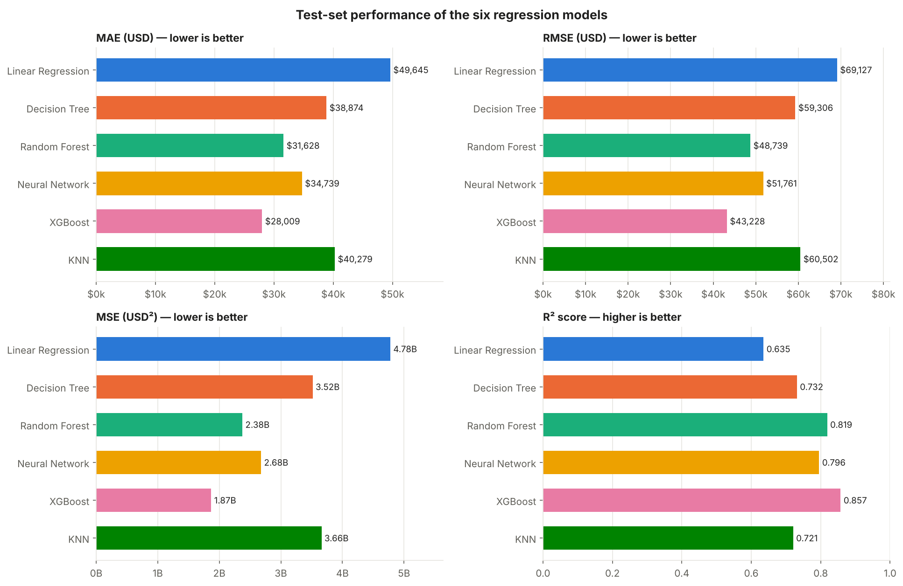
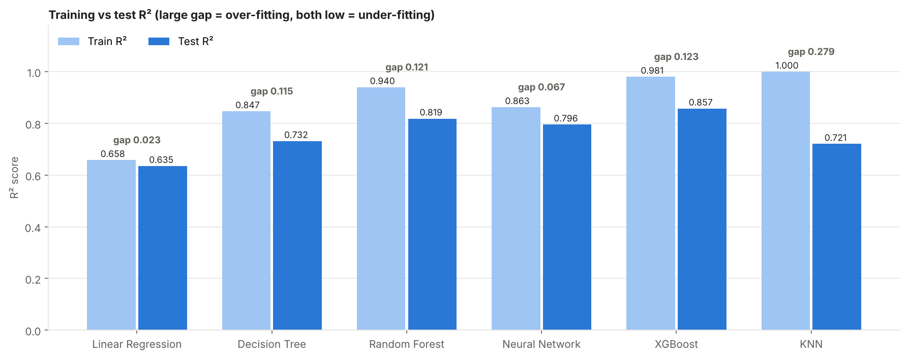
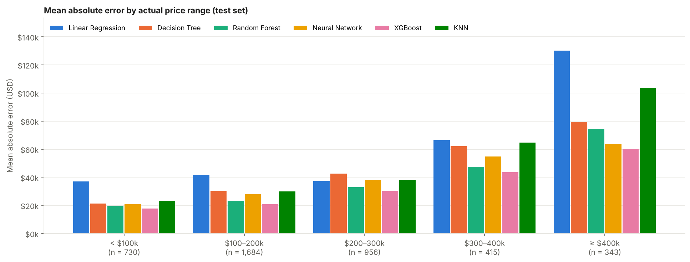
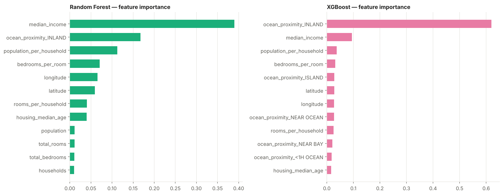

# Comparative Implementation of Machine Learning Regression Algorithms

House price prediction on the **California Housing** dataset with six regression algorithms, each solved twice:

1. **Handwritten:** working procedure, equations and a step-by-step numeric solution on a small sample → [`handwritten/HANDWRITTEN_SOLUTION.md`](handwritten/HANDWRITTEN_SOLUTION.md) ([PDF](handwritten/HANDWRITTEN_SOLUTION.pdf))
2. **Python:** a full implementation on all 20,640 districts → [`train.py`](train.py), [`regression_comparison.ipynb`](regression_comparison.ipynb)

**Full illustrated report (18 figures, all tables, analysis and conclusion): [`REPORT.md`](REPORT.md)** ([PDF](REPORT.pdf))

| # | Algorithm | Library |
|---|---|---|
| 1 | Linear Regression | `sklearn.linear_model.LinearRegression` |
| 2 | Decision Tree Regression | `sklearn.tree.DecisionTreeRegressor` |
| 3 | Random Forest Regression | `sklearn.ensemble.RandomForestRegressor` |
| 4 | Neural Network Regression | `sklearn.neural_network.MLPRegressor` |
| 5 | XGBoost Regression | `xgboost.XGBRegressor` |
| 6 | K-Nearest Neighbors Regression | `sklearn.neighbors.KNeighborsRegressor` |

## Results

**Best model: XGBoost.** It has the highest R² (0.857) and the lowest MAE (\$28,009), MSE and RMSE (\$43,228) on the test set.

| Rank | Model | MAE (USD) | MSE (USD²) | RMSE (USD) | R² | Train R² | 5-fold CV RMSE (USD) | Train time (s) |
|---:|---|---:|---:|---:|---:|---:|---:|---:|
| 1 | **XGBoost** | **28,009** | **1.869e+09** | **43,228** | **0.8574** | 0.9806 | 44,669 ± 780 | 1.48 |
| 2 | Random Forest | 31,628 | 2.375e+09 | 48,739 | 0.8187 | 0.9402 | 49,431 ± 1,042 | 3.28 |
| 3 | Neural Network | 34,739 | 2.679e+09 | 51,761 | 0.7955 | 0.8630 | 52,358 ± 1,142 | 10.30 |
| 4 | Decision Tree | 38,874 | 3.517e+09 | 59,306 | 0.7316 | 0.8470 | 59,066 ± 1,028 | 0.11 |
| 5 | KNN (k = 11) | 40,279 | 3.661e+09 | 60,502 | 0.7207 | 1.0000 | 60,388 ± 1,077 | 0.02 |
| 6 | Linear Regression | 49,645 | 4.779e+09 | 69,127 | 0.6353 | 0.6582 | 67,859 ± 1,312 | 0.04 |

*Test set = 4,128 districts (20%). CV RMSE = 5-fold cross-validation on the training set only. Training times are from a 2-core CPU.*

### Actual vs predicted values




### Metric comparison


### Over-fitting check and error by price range



### Feature importance


More figures (EDA, map, decision tree, neural-network training curve, cross-validation, residuals, error map) are in [`REPORT.md`](REPORT.md).

## Experimental setup (identical for all six models)

| Item | Setting |
|---|---|
| Dataset | California Housing (1990 census), 20,640 districts, file `data/housing.csv` |
| Target variable | `median_house_value` (USD) |
| Input features (12) | longitude, latitude, housing_median_age, total_rooms, total_bedrooms, population, households, median_income, ocean_proximity, plus 3 engineered: rooms_per_household, bedrooms_per_room, population_per_household |
| Split | 80:20 train/test, `random_state=42` → 16,512 train / 4,128 test |
| Missing values | `total_bedrooms` (207 missing) → median of the training set |
| Scaling | `StandardScaler` (z-score) on numeric features, fitted on the training set only |
| Encoding | One-hot encoding of `ocean_proximity` |
| Leakage control | Preprocessing and model are in one `Pipeline`, so the test set is never seen during fitting |

Scaling is required for KNN, because it uses distances, and for the Neural Network, because it is trained by gradient descent. Tree models do not need it, but it does not change their results, so every model uses the same pipeline.

### Hyper-parameters
| Model | Settings |
|---|---|
| Linear Regression | Ordinary Least Squares |
| Decision Tree | `max_depth=12, min_samples_leaf=10` |
| Random Forest | `n_estimators=150, max_features=0.5, min_samples_leaf=3` |
| Neural Network | MLP 128-64-32, ReLU, Adam, `alpha=1e-3`, batch 64, early stopping; target standardised during training |
| XGBoost | `n_estimators=800, learning_rate=0.05, max_depth=7, subsample=0.8, colsample_bytree=0.8, reg_lambda=1` |
| KNN | `k=11` (chosen by 5-fold CV on the training set, see `results/figures/knn_k_selection.png`), distance-weighted |

## Strengths and limitations

| Algorithm | Strengths | Limitations (as seen in this experiment) |
|---|---|---|
| **Linear Regression** | Very fast, interpretable coefficients, no tuning, strong baseline | Can only fit a flat hyperplane. Train and test R² are both about 0.64, which is clear **underfitting**. It produced impossible negative prices for some cheap districts. |
| **Decision Tree** | Handles non-linearity and feature interactions, needs no scaling, easy to explain | High variance. Predictions are piece-wise constant (the horizontal bands in the scatter plot). Accuracy depends heavily on depth. |
| **Random Forest** | Averaging 150 decorrelated trees cuts the single tree's RMSE by about 18%. Robust and gives feature importance. | Largest saved model (about 18 MB). Slower at prediction time. Cannot extrapolate beyond the training range. |
| **Neural Network** | Learns smooth non-linear functions and was third best | Needs scaling (inputs and target), tuning and the longest training time. It is a black box and is sensitive to initialisation. |
| **XGBoost** | Each tree corrects the previous trees' errors. L2 regularisation, shrinkage and subsampling control overfitting. The `hist` algorithm is fast and it handles missing values natively. | Many hyper-parameters. Train R² (0.98) is far above test R² (0.86), so it would overfit further without regularisation. It is less interpretable. |
| **KNN** | Simple, no training phase, naturally non-linear | Must scale features. Prediction is slow on big data. Accuracy suffers from the curse of dimensionality (16 inputs). It memorises the training set: train R² is 1.0 because each point is its own nearest neighbour. |

All models share one weakness: the target is **capped at \$500,001** (965 districts). This is the vertical column of points at the right edge of every scatter plot, and no model can predict those districts correctly.

## Conclusion: why XGBoost wins

XGBoost is best on **all four metrics**. Its RMSE is **11.3% lower** than the runner-up (Random Forest) and **37.5% lower** than Linear Regression. It also has the lowest cross-validated RMSE with the smallest spread (44,669 ± 780), so the win does not depend on one lucky split.

House value depends **non-linearly** on income and location and on the **interactions** between them; for example, the same income is worth much more on the coast than inland. In the XGBoost feature importance, `ocean_proximity_INLAND` dominates, followed by `median_income`. Tree ensembles model these interactions automatically:

- **Bagging** (Random Forest) mainly reduces variance by averaging independent trees.
- **Boosting** (XGBoost) reduces bias as well: it fits each new tree to the gradient (residual errors) of the current model and adds it with a small learning rate. Regularisation (λ, η, subsampling) keeps the variance under control.

The Neural Network can in principle learn the same function, but on tabular data of this size it is harder to tune and still trails the tree ensembles. Gradient-boosted trees are usually the strongest choice on tabular data, and this experiment agrees with that.

## Project structure

```
ml-regression-comparison/
├── data/
│   ├── housing.csv                     California Housing dataset (full, 20,640 rows)
│   ├── train.csv                       the exact 80% training set (16,512 rows)
│   └── test.csv                        the exact 20% test set (4,128 rows)
├── src/
│   ├── data_preprocessing.py           load, feature engineering, 80:20 split, scaler/encoder
│   ├── models.py                       the six models (as Pipelines)
│   ├── evaluate.py                     MAE, MSE, RMSE, R²
│   └── visualize.py                    all figures
├── train.py                            trains, evaluates and saves everything
├── predict.py                          loads saved models and predicts new districts
├── make_report.py                      builds REPORT.md / REPORT.pdf from the results
├── REPORT.md / REPORT.pdf              full illustrated report
├── regression_comparison.ipynb         executed notebook (full walkthrough)
├── models/*.joblib                     the 6 trained models (preprocessing included)
├── results/
│   ├── metrics.csv / metrics.md        comparison table
│   ├── summary.json                    run summary
│   ├── test_predictions.csv            actual vs predicted for every test row
│   ├── train_predictions.csv           actual vs predicted for every training row
│   ├── error_by_price_range.csv        MAE per price band for every model
│   ├── linear_regression_coefficients.csv
│   └── figures/*.png                   18 figures
└── handwritten/
    ├── HANDWRITTEN_SOLUTION.md / .pdf  step-by-step hand solutions of all 6 algorithms
    └── hand_calculations.py            generates & verifies every hand-calculated number
```

## How to run

```bash
git clone https://github.com/asad-mashood/ml-regression-comparison.git
cd ml-regression-comparison
pip install -r requirements.txt

python train.py                  # trains all 6 models, writes models/ and results/ (~1 min)
python train.py --no-cv          # faster, skips cross-validation
python make_report.py            # rebuild REPORT.md / REPORT.pdf from the results
python predict.py                # predict example districts with every saved model
python handwritten/hand_calculations.py   # regenerate the handwritten solution
jupyter notebook regression_comparison.ipynb
```

Use a saved model in your own code:

```python
import joblib
from src.data_preprocessing import add_features, FEATURES
model = joblib.load("models/xgboost.joblib")      # preprocessing is inside the pipeline
price = model.predict(add_features(new_df)[FEATURES])
```

## Handwritten part

[`handwritten/HANDWRITTEN_SOLUTION.md`](handwritten/HANDWRITTEN_SOLUTION.md) works through a 10-row sample of the same dataset, split 80:20 into 8 training rows and 2 test rows. For each algorithm it gives:

- **Working procedure**, step by step
- **Mathematical equations**: OLS and the Normal Equation, CART SSE splitting, bagging average, forward and back-propagation, the XGBoost gradient/hessian/gain/leaf weight, and Euclidean distance
- **Full numeric solution**: deviation tables, every candidate split, bootstrap samples, one back-propagation update, two boosting rounds, distance tables
- **MAE / MSE / RMSE / R²** computed by hand and a comparison table

The arithmetic was generated by `hand_calculations.py`, and the Linear Regression, Decision Tree and KNN results were cross-checked against scikit-learn.

## Dataset source

Pace, R. K. & Barry, R. (1997), *Sparse Spatial Autoregressions*, Statistics & Probability Letters. The CSV is taken from the public repository of *Hands-On Machine Learning* (A. Géron).
