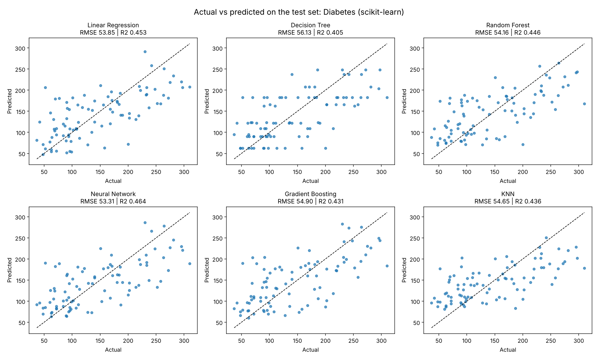
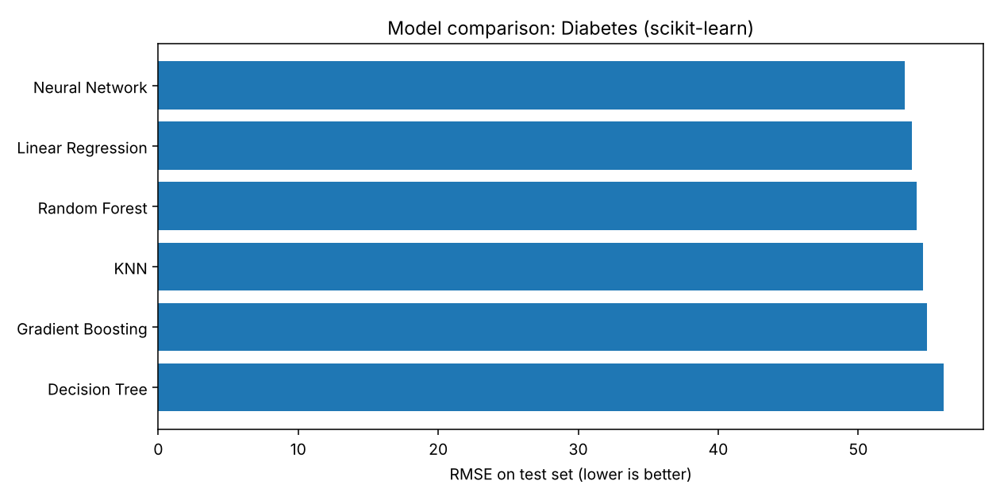

# Comparing six regression algorithms on the same data

One prediction problem, six algorithms, one fair test.

| Algorithm | Needs feature scaling | Idea in one line |
|---|---|---|
| Linear Regression | Recommended | Best straight line (least squares) |
| Decision Tree | No | Split the data by simple rules, predict the leaf mean |
| Random Forest | No | Average many trees built on random samples |
| Neural Network (MLP) | Yes | Layers of weighted sums trained by gradient descent |
| XGBoost | No | Trees added one by one, each fixing the errors so far |
| K-Nearest Neighbors | Yes | Average the k most similar rows |

## What is in this repo

- `regression_comparison.py`: Python implementation of all six models with the same dataset, features, target and 80:20 train/test split. Reports MAE, MSE, RMSE and R2, and saves the comparison table and plots to `results/`.
- `HANDWRITTEN.md`: the working, equations and a step-by-step hand calculation for each algorithm on a six-row sample.
- `handwritten_examples.py`: generates `HANDWRITTEN.md`, so every hand calculation can be checked.

## Run it

```bash
pip install -r requirements.txt
python regression_comparison.py                      # Diabetes dataset, bundled with scikit-learn
python regression_comparison.py --dataset california # California house prices (downloads once)
python handwritten_examples.py
```

## Results

Dataset: Diabetes (scikit-learn), 80:20 split, random_state=42

| Model | MAE | MSE | RMSE | R2 |
|---|---|---|---|---|
| Neural Network | 42.72 | 2841.88 | 53.31 | 0.464 |
| Linear Regression | 42.79 | 2900.19 | 53.85 | 0.453 |
| Random Forest | 43.89 | 2933.18 | 54.16 | 0.446 |
| KNN | 44.58 | 2986.22 | 54.65 | 0.436 |
| Gradient Boosting (sklearn, XGBoost not installed) | 44.47 | 3013.81 | 54.90 | 0.431 |
| Decision Tree | 45.32 | 3150.61 | 56.13 | 0.405 |





**Note on the boosting row.** The committed results were produced on a machine without the `xgboost` package, so that row uses scikit-learn's `GradientBoostingRegressor` as a stand-in. With `xgboost` installed the script uses `XGBRegressor` automatically. Re-run it and commit the new `results/` to replace this row.

## Discussion

- **All six models land close together** (RMSE about 53 to 56, R2 about 0.40 to 0.46). The dataset has 442 rows and 10 features, and much of the target cannot be explained by these features, so extra model complexity has little to work with.
- **The neural network is best by a small margin**, with linear regression almost equal. The gap between first and second is smaller than what a different random split could change, so the fair conclusion is that a linear model is already enough here.
- **The single decision tree is the weakest.** It predicts in steps and is sensitive to the training sample. Random forest and boosting improve on it by combining many trees.
- **Preprocessing.** Features are standardised inside a pipeline for linear regression, the neural network and KNN, so the scaler is fitted on the training rows only. Tree models are left unscaled because splits do not depend on scale.

| Algorithm | Strengths | Limitations |
|---|---|---|
| Linear Regression | Fast, easy to explain, strong baseline | Only straight-line relationships |
| Decision Tree | Readable rules, no scaling | Overfits, unstable |
| Random Forest | Robust, little tuning | Slower, harder to explain |
| Neural Network | Learns complex patterns | Needs scaling, tuning and more data |
| XGBoost | Often best on larger tabular data | Several hyperparameters to tune |
| KNN | Simple, no training step | Slow at prediction, weak with many features |

Hyperparameters were fixed before testing and not tuned on the test set. A next step would be k-fold cross-validation.
